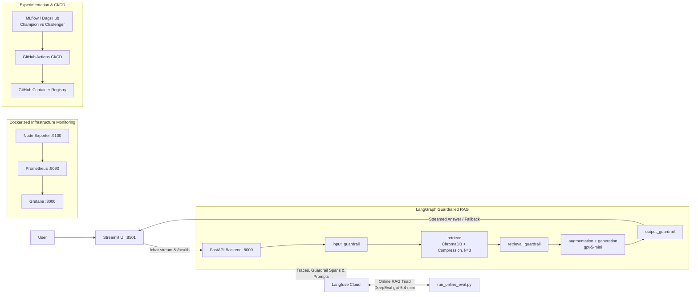
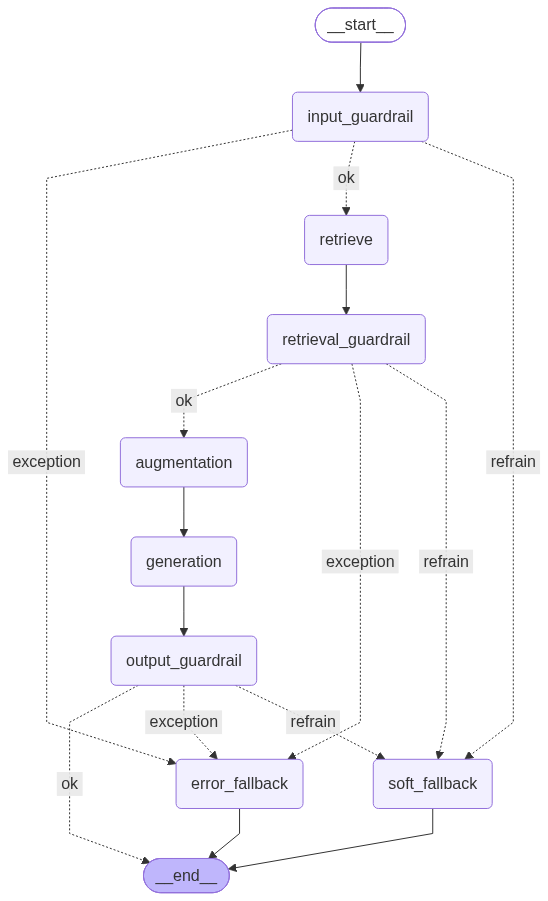

# LectureIQ — Production LLMOps RAG Assistant

A production-oriented Retrieval-Augmented Generation (RAG) service for technical Q&A over long-form speech-to-text lecture transcripts, demonstrating a complete LLMOps lifecycle: three-layer guardrails, externalized prompt management, synthetic golden-set generation, LLM-as-judge offline evaluation, statistical regression/promotion gates, online RAG Triad scoring, and dual-layer observability (Langfuse + Prometheus/Grafana).

<p>
  
  
  
  
  
  
  
  
</p>

---

## Overview

Raw lecture transcripts contain conversational filler, fragmented sentences, and no structural headings—making naive RAG prone to noisy retrieval and hallucinations. LectureIQ runs retrieval, contextual compression, and generation as an explicit **LangGraph** state machine wrapped in three validation gates (`input_guardrail`, `retrieval_guardrail`, and `output_guardrail`).

Around the runtime sits an automated evaluation and observability loop: every configuration change is scored offline against a synthetic golden dataset in **MLflow (DagsHub)**, gated by noise- and drift-aware `pytest` regression/promotion checks, built into multi-stage Docker images published to **GHCR**, and continuously monitored via **Langfuse online evals** and a local **Prometheus + Grafana** stack.

### Key Highlights

- **Graph-based RAG with Contextual Compression** — discrete, testable LangGraph nodes combining ChromaDB (`text-embedding-3-small`, 1024 dims) with `gpt-5-mini` contextual compression to strip transcript filler at query time.
- **Three-layer Guardrails** — jailbreak, PII, and topic validation on user input; prompt-injection checks on retrieved context; relevancy and reading-time checks on generated output—routing cleanly to `error_fallback` (`exception`) or `soft_fallback` (`refrain`).
- **Externalized Prompt Management** — system prompts are versioned and label-promoted in Langfuse, fetched dynamically via `params.yaml` (`prompt_label`), and linked back to every generation trace.
- **Offline Synthetic Evaluation & Statistical Gates** — DeepEval `Synthesizer` (`gpt-5.4-mini`) generates evolved Q&A pairs scored across 7 RAG + `GEval` metrics; `test_regression.py` and `test_promotion.py` enforce noise- and historical-variance thresholds before promoting a challenger.
- **Online Reference-Free RAG Triad** — `src/evals/online_evals/run_online_eval.py` incrementally evaluates live `production` Langfuse traces via a UTC checkpoint and pushes idempotent `answer_relevancy`, `faithfulness`, and `contextual_relevancy` scores back to Langfuse.
- **Dual-Layer Observability** — AI quality, token cost, guardrail trip rates, and latency tracked in **Langfuse**; container host CPU, memory, disk, and network metrics scraped by **Prometheus + Node Exporter** and visualized in **Grafana** inside the same Docker Compose stack.
- **Idempotent Ingestion & Automated GHCR CD** — content-hashed chunks re-embed only modified documents; GitHub Actions builds and publishes API and frontend images to **GHCR (`ghcr.io`)**, with optional cloud deployment cleanly gated behind `vars.ENABLE_AZURE_DEPLOY == 'true'`.

---

## Architecture



### Served LangGraph State Machine



Each guardrail node (`input_guardrail`, `retrieval_guardrail`, `output_guardrail`) emits `ok`, `exception`, or `refrain`:
- `ok` advances to the next stage (or `__end__` after `output_guardrail`).
- `exception` routes immediately to `error_fallback` (critical safety/system fallback).
- `refrain` routes immediately to `soft_fallback` (asks the user to rephrase or narrow the question).

The plain (non-guardrailed) graph is retained for offline evaluation runs so retrieval and generation quality can be measured independently of guardrail refusals.

---

## Evaluation Results (MLflow — Champion vs. Candidate)

Offline evaluations use `gpt-5.4-mini` as judge on `evaluation_dataset_final` (`k=3`, `text-embedding-3-small` at 1024 dims, `o200k_base` tokenizer, contextual compression enabled).

To test whether tighter chunks improved retrieval precision on noisy transcripts, a challenger (`chunk_size=270`, `chunk_overlap=30`) was evaluated against the Champion (`chunk_size=300`, `chunk_overlap=25`):

| Metric | Champion (`300 / 25`) | Candidate (`270 / 30`) | Delta | Outcome |
| :--- | :---: | :---: | :---: | :---: |
| **Contextual Recall** | **0.96** | 0.94 | -0.02 | |
| **Contextual Precision** | 0.99 | **1.00** | +0.01 | |
| **Contextual Relevancy** | **0.71** | 0.67 | -0.04 | |
| **Faithfulness** | 0.97 | **0.99** | +0.02 | |
| **Answer Relevancy** | **0.88** | 0.71 | -0.17 | |
| **Answer Correctness** | **0.87** | 0.79 | -0.08 | |
| **Simple Explanation** | **0.89** | 0.74 | -0.15 | |
| **MLflow Stage** | **Champion** | **Archived** | — | **Candidate Rejected** |

> **Key Finding:** Tightening chunks to 270 tokens raised Contextual Precision (`1.00`) and Faithfulness (`0.99`), but severed multi-sentence spoken explanations—causing sharp drops in Answer Relevancy (-0.17), Simple Explanation (-0.15), and Answer Correctness (-0.08). The statistical regression gate caught the degradation and kept the `300 / 25` Champion in production.

### Online Production Snapshot (Langfuse)
- **Indexed Corpus:** 14 transcript files / 1,064 chunks (`rag_demo` collection)
- **Online RAG Triad (`n=6` evaluated traces):** Answer Relevancy **1.00** (σ=0.00) | Faithfulness **1.00** (σ=0.00) | Contextual Relevancy **0.87** (σ=0.12)
- **Avg. Observation Metrics:** 5.92 s latency | 129.6 tokens | $0.00016 / observation
- **Stage Latency Bottleneck (p50):** `retrieve` (13.92 s, incl. contextual compression) → `generation` (5.38 s) → `input_guardrail` (4.68 s) → `retrieval_guardrail` (2.62 s) → `output_guardrail` (1.91 s) → `augmentation` (1 ms)

---

## Repository Layout

| Path | Purpose |
| :--- | :--- |
| `src/app/` | LangGraph RAG workflows, three-layer guardrails, ChromaDB store, Langfuse prompt versioning |
| `src/api/` | FastAPI service — `chat`, `health`, and admin-key-protected `vector-store` / `debug` routers |
| `src/frontend/` | Streamlit chat UI (`LectureIQ`) with session persistence and live health probes |
| `src/config/` | `params.yaml` loader with strict Pydantic validation |
| `src/data/` | DeepEval golden-set synthesis and evaluation-set generation |
| `src/evals/` | Offline DeepEval metric suite and `online_evals/run_online_eval.py` |
| `src/experiment/` | MLflow experiment pipeline, vector-store rebuild, and challenger promote/reject scripts |
| `utils/` | Transcript cleaning, MLflow helpers, and `compute_*_thresholds.py` scripts |
| `tests/` | `test_regression.py`, `test_promotion.py`, and API demo scripts |
| `monitoring/` | `prometheus.yml` scrape configuration for local Dockerized monitoring |
| `docker/` | Multi-stage `Dockerfile.api`, `Dockerfile.frontend`, and build-time ingestion entrypoint |
| `reports/` | Evaluation reports and `graph.png` |
| `.github/workflows/` | `ci.yaml` (experiment → gates → promote) and `cd.yaml` (GHCR image build + gated cloud deploy) |

---

## Tech Stack

| Concern | Tooling |
| :--- | :--- |
| **Orchestration** | LangGraph, LangChain |
| **Vector Store** | ChromaDB (persistent, baked at API image build time) |
| **Models** | OpenAI (`gpt-5-mini` generation/compression, `text-embedding-3-small`, `gpt-5.4-mini` judge) |
| **Guardrails** | Guardrails AI + custom LLM validators (jailbreak, PII, topic) + hub validators (prompt-injection, relevancy, reading-time) |
| **LLM Observability** | Langfuse (traces, guardrail spans, prompt versioning, online RAG Triad scores) |
| **Infra Monitoring** | Prometheus, Node Exporter, Grafana (Docker Compose) |
| **Evaluation & Tracking** | DeepEval (`Synthesizer`, RAG metrics, `GEval`), MLflow, DagsHub |
| **API / UI** | FastAPI, Uvicorn, Streamlit |
| **Containers & CI/CD** | Python 3.13, `uv`, Pydantic, `pytest`, Docker Compose, GitHub Actions, GHCR |

---

## Quickstart (100% Local via Docker Compose)

### 1. Prerequisites
- Docker Desktop (with BuildKit enabled)
- Python 3.13 + [`uv`](https://docs.astral.sh/uv/) (for running offline/online eval scripts locally)
- API keys for OpenAI, Langfuse, and DagsHub/MLflow

### 2. Configure Environment
```bash
git clone https://github.com/RogueNinja240/<your-repo-name>.git
cd <your-repo-name>
cp .env.example .env
```

Set the required keys in `.env`:
```dotenv
OPENAI_API_KEY=...
LANGFUSE_SECRET_KEY=...
LANGFUSE_PUBLIC_KEY=...
LANGFUSE_BASE_URL=https://cloud.langfuse.com
LANGFUSE_TIMEOUT=30
ADMIN_API_KEY=...
```

*(Setting `LANGFUSE_TIMEOUT=30` prevents `httpx.ReadTimeout` errors when fetching large `retrieve` spans during online evaluations.)*

### 3. Build & Start the Full Stack
Export `OPENAI_API_KEY` in your shell—Docker mounts it as a **BuildKit build-time secret** during `Dockerfile.api` ingestion so credentials are never written into an image layer:

```powershell
# PowerShell
$env:OPENAI_API_KEY = "sk-..."
docker compose up -d --build
```

This starts all five services on a shared Docker network:

| Service | URL | Purpose |
| :--- | :--- | :--- |
| **LectureIQ UI** | `http://localhost:8501` | Chat interface, session history, LLM & Retriever health checks |
| **FastAPI Docs** | `http://localhost:8000/docs` | Interactive API documentation |
| **Node Exporter** | `http://localhost:9100/metrics` | Raw Linux/WSL2 host metrics |
| **Prometheus** | `http://localhost:9090/targets` | Scrapes `node-exporter:9100` every 15s (`--web.enable-lifecycle` enabled) |
| **Grafana** | `http://localhost:3000` | Login `admin` / `admin`; connect Prometheus at `http://prometheus:9090` and import dashboard **`1860`** |

### 4. Run Local Without Docker (Optional)
```bash
uv sync
uv run python src/app/update_system_prompt.py
uv run uvicorn api.main:app --reload --app-dir src
uv run streamlit run src/frontend/app.py
```

---

## API Reference

| Method | Endpoint | Auth | Description |
| :--- | :--- | :--- | :--- |
| `POST` | `/chat` | — | Streams a grounded answer for `{"query": "...", "session_id": "..."}` |
| `GET` | `/chat/files` | — | Lists indexed source transcript files |
| `GET` | `/health` | — | Liveness check |
| `GET` | `/health/dependencies` | — | Live OpenAI LLM + ChromaDB retriever health probes |
| `GET` | `/internal/vector-store/chunks/count` | `X-Admin-Key` | Returns indexed chunk count |
| `POST` | `/internal/vector-store/transcripts/sync` | `X-Admin-Key` | Cleans, chunks, embeds, and upserts `data/raw/` (content-hashed idempotency) |
| `POST` | `/internal/debug/rag` | `X-Admin-Key` | Executes plain RAG graph and returns full state |
| `POST` | `/internal/debug/rag_with_guardrails` | `X-Admin-Key` | Executes guardrailed graph and returns full state + guardrail statuses |

---

## Dual-Layer Observability

### 1. LLM & Guardrail Observability (Langfuse)
- **Root Trace & Session Grouping:** `src/api/routers/chat.py` opens a `chat-response` root span and propagates `session_id` so multi-turn chats group into a single Langfuse session.
- **Nested Graph & Guardrail Spans:** LangGraph execution runs with `langfuse.langchain.CallbackHandler`; each guardrail node records a dedicated `guardrail` observation (`ok` / `refrain` / `exception`) so trip rates are directly queryable.
- **Prompt Attribution & Environment Isolation:** Prompts are linked via `metadata={"langfuse_prompt": system_prompt}`, and Docker Compose sets `LANGFUSE_TRACING_ENVIRONMENT=production` to separate container traffic from local dev runs.
- **Online RAG Triad Scoring:**
  ```powershell
  uv run src\evals\online_evals\run_online_eval.py
  ```
  Incrementally fetches new `production` traces since `eval_checkpoint.json`, skips fallback responses, computes `answer_relevancy`, `faithfulness`, and `contextual_relevancy` with DeepEval, and writes idempotent scores (`score_id="{trace_id}_{name}"`) back to Langfuse.

### 2. Infrastructure Monitoring (Prometheus + Grafana)
- `node-exporter` exposes CPU, RAM, disk, and network counters from the container host.
- `prometheus` scrapes `node-exporter:9100` over Docker Compose's internal DNS (`monitoring/prometheus.yml`) with live config reload support (`POST http://localhost:9090/-/reload`).
- `grafana` visualizes host CPU %, memory headroom, and disk I/O alongside custom PromQL panels (e.g. `100 - (avg by (instance) (rate(node_cpu_seconds_total{mode="idle"}[5m])) * 100)`).

---

## LLMOps Workflow & CI/CD

### Offline Experiment & Promotion Gates
```bash
# Run full evaluation pipeline and log Challenger to MLflow/DagsHub
uv run python src/experiment/execute_experiment_pipeline.py

# Statistical regression & promotion checks against thresholds.json
uv run pytest tests/test_regression.py   # fails on drop > 2 * (historical + noise)
uv run pytest tests/test_promotion.py    # requires >= 5/7 metrics >= champion, no regression > 2 * noise

# Promote or reject Challenger
uv run python src/experiment/promote_challenger.py
uv run python src/experiment/reject_challenger.py
```

### Automated Container Delivery (GHCR)
- **`ci.yaml`** runs experiments, statistical gates, and challenger promotion on config changes.
- **`cd.yaml`** triggers after CI succeeds, builds multi-stage `api` and `frontend` Docker images, and pushes them to **GitHub Container Registry (`ghcr.io`)**. Cloud deployment jobs are intentionally gated behind `vars.ENABLE_AZURE_DEPLOY == 'true'` so automated container builds stay active at zero cloud cost.

---

## Screenshots & Documentation

- **[Technical Engineering Report](docs/TECHNICAL_REPORT.md)** — Deep dive into chunking trade-offs, evaluation design, dual-layer observability, and engineering fixes.

| View | Screenshot |
| :--- | :--- |
| **LectureIQ Chat UI** | `` |
| **Langfuse Trace & Guardrail Spans** | `` |
| **Online RAG Triad Analytics** | `` |
| **Grafana Infrastructure Dashboard** | `` |
